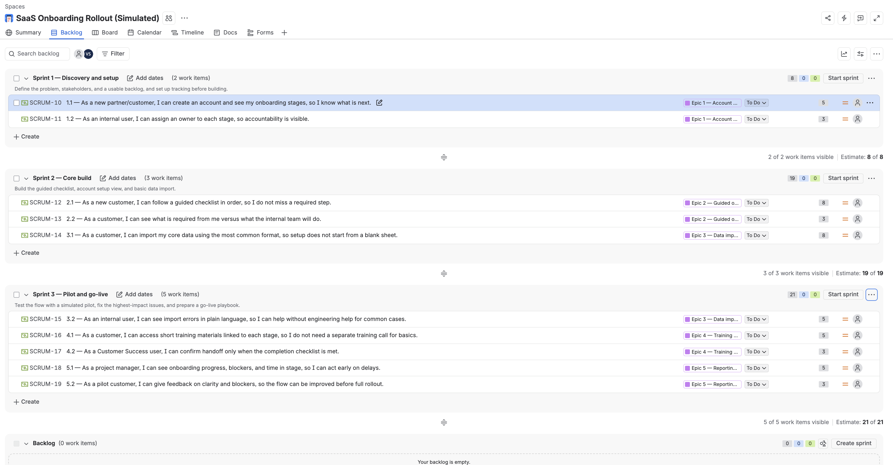
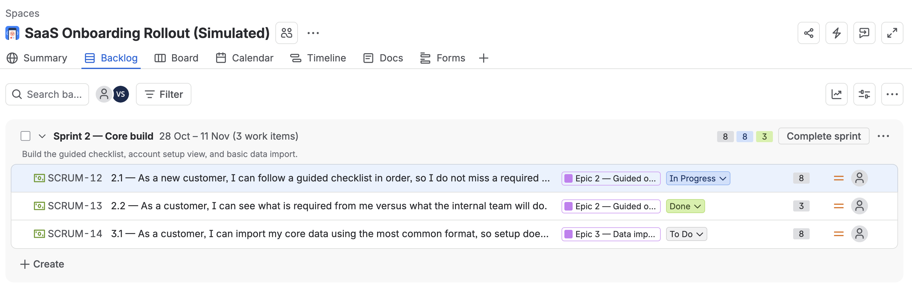
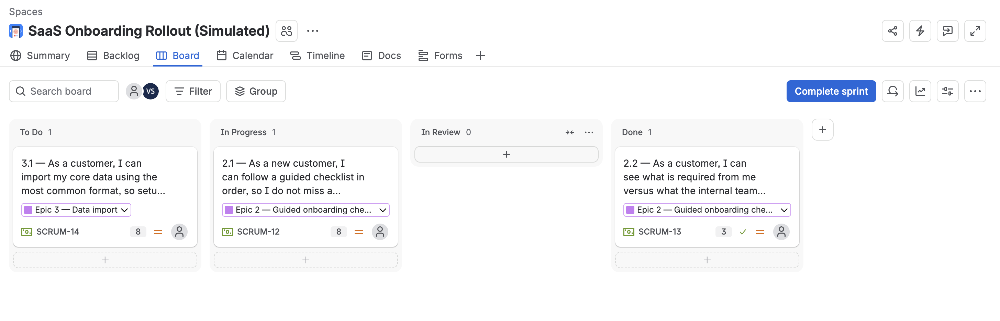
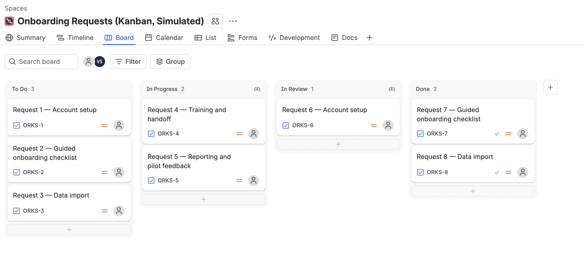
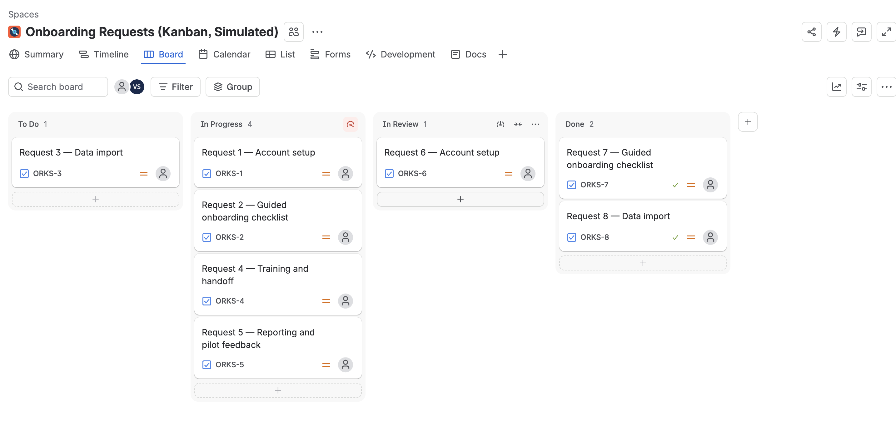

# Agile SaaS Onboarding Rollout — Project

**Author:** Vimlesh Sonawane, Project Manager
**Status:** Self-initiated project — simulated scenario, not a client engagement and not an employer project.
**Timeline in the project:** 6 weeks, 3 two-week sprints
**Live demo:** https://agile-demo.vimleshsonawane.com/ (simulated; no real customer data)

## What I created

I created a complete, end-to-end onboarding rollout plan for a B2B partner/client program, plus a working demo of the onboarding flow:

- A project charter, stakeholder analysis, and scope definition
- A product backlog with epics, user stories, and acceptance criteria
- Sprint plans for Sprint 1, 2, and 3, with goals, scope, and review points
- A RAID log (risks, assumptions, issues, dependencies) with mitigations
- A working demo in `demo/index.html`: an interactive Agile board — product backlog, Sprint 1–3 boards, sprint goals and point totals, remaining-work tracking, RAID risks, roadmap, and custom-story adding
- A retrospective and a set of honest resume bullets in `docs/resume-bullets.md`

## What the demo includes

- Sprint boards for 3 two-week sprints: 10 user stories, 48 illustrative points, 5 epics. Move stories through To Do, In Progress, In Review, and Done, and watch remaining points change.
- Product backlog with an epic filter and an "Add your own story" form (session only, not saved).
- Story Details panel showing each story's acceptance criteria.
- Risk log with 4 risks and their mitigations, and milestones for each sprint.
- The charter's five success criteria and links to the project documents.
- Kanban view (after go-live): work-in-progress limits (In Progress 3, In Review 2), blocked cards, and a demo-day counter.
- Flow metrics (simulated): card age, average cycle time, cards completed in the last 7 days, and a cumulative flow diagram.

## How to read the numbers

Every number in the demo is simulated. The 21-day to 10-day onboarding figure is a target, not a result. Story points are illustrative, not a real team's velocity. The Kanban cards (Request 1 to Request 8) and their starting history are illustrative, so the flow metrics show how the measures work, not real team performance. The sprint boards and the Kanban view show two phases: Scrum to build the onboarding flow, and Kanban to run requests after go-live.

## Same backlog in Jira (simulated data)

I set up the same simulated backlog and board in Jira (free plan) to practice the tools. Everything below is simulated: there is no real team, customer, or company data.

*Scrum space: the same 10 user stories (48 points) across 3 sprints and 5 epics as the demo.*

*Sprint 2 running, with story 2.1 In Progress, 2.2 Done, and 3.1 To Do.*

*The same sprint on the board, with the four columns used in the demo: To Do, In Progress, In Review, and Done.*

*Kanban space (after go-live): the same 8 illustrative request cards, in the same starting columns as the demo. In Progress and In Review each show a work-in-progress limit icon.*

*In Progress holding 4 cards, more than its work-in-progress limit. Jira turns the column's limit icon red as a warning.*

## What I analysed

I analysed a manual onboarding process that, in the simulated scenario, took 21 days and depended on scattered checklists, email follow-ups, and a few individuals.

The bottlenecks I identified were:

1. No single view of onboarding progress for the customer or the internal team
2. Unclear ownership for each onboarding stage
3. Security/compliance review left until late, creating launch delays
4. Training handoff with no completion criteria
5. No consistent way to track blockers or pilot feedback

## Significance

This project shows end-to-end project management thinking, not just theory:

- Scope, schedule, and change control in a time-boxed Agile plan
- Stakeholder analysis and communication for different partner types
- Risk management with early mitigations, not risks listed at the end
- Data-informed decisions: I used pilot simulation feedback to redesign two steps that caused drop-off
- A tangible output a hiring manager can open, click through, and discuss in an interview

## Tools and methodologies used

- **Methodologies:** Agile, Scrum (3 sprints), stakeholder analysis, RAID risk management, change control, retrospectives
- **Tools in the project:** Jira-style backlog and sprint board (represented here in `docs/backlog.md` and `docs/sprint-plans.md`), Confluence-style documentation, spreadsheet-style tracking for pilot feedback, and a static web demo for Vercel deployment
- **Skills demonstrated:** scope definition, backlog refinement, sprint planning, risk mitigation, stakeholder communication, pilot analysis, and go-live planning

## How to read this repo

Start with `docs/charter.md`, then `docs/backlog.md`, then `docs/sprint-plans.md`. The RAID log, retrospective, and resume bullets show the decisions and trade-offs behind the plan.

## Honest framing note

Any numbers in this repo labelled as targets or pilot simulation results are targets for the simulated scenario, not results from a real employer. Employers, titles, dates, and counts from my real background are kept exactly as given in my portfolio and are not changed here. No silent upgrades are used: coordinated work is described as coordinated, created work is described as created, and analysed work is described as analysed.
